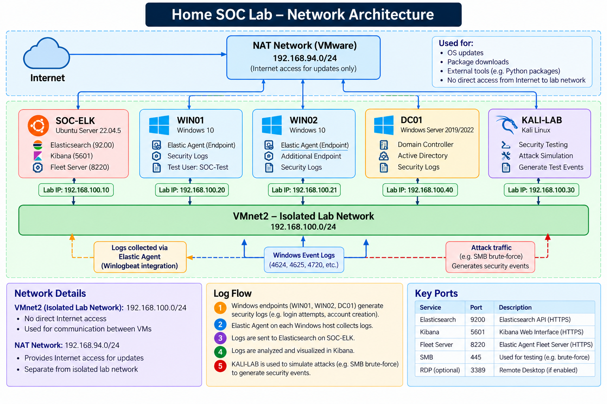

# Home SOC Lab Architecture

This directory documents the virtual network architecture of my Home Security Operations Center (SOC) lab.

## Network Architecture Diagram

## Lab Infrastructure

| Virtual Machine | Role | Lab IP Address |
|---|---|---|
| SOC-ELK | Elasticsearch, Kibana, Fleet Server | 192.168.100.10 |
| WIN01 | Windows endpoint | 192.168.100.20 |
| WIN02 | Windows endpoint | 192.168.100.21 |
| DC01 | Active Directory Domain Controller | 192.168.100.40 |
| KALI-LAB | Security testing and attack simulation | 192.168.100.30 |

## Network Configuration

**VMnet2 — Isolated Lab Network:** `192.168.100.0/24`

Used for communication between the virtual machines, security event collection, and controlled attack simulations.

**VMware NAT Network:** `192.168.94.0/24`

Used for operating system updates, package installation, and downloading necessary tools.

## Security Monitoring

- Elastic Agent collects Windows security events.
- Elasticsearch stores and indexes security telemetry.
- Kibana provides alert monitoring, detection rules, and incident investigations.
- Kali Linux generates controlled security testing activity.
- Python scripts retrieve, analyze, prioritize, and export security alerts.
