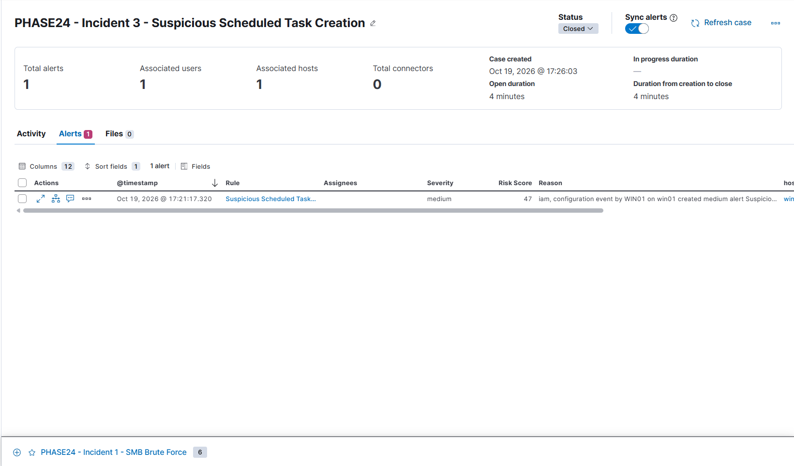

# Incident 03 — Suspicious Scheduled Task Creation

## Incident Summary

A controlled scheduled-task persistence simulation was performed on WIN01 to validate Elastic Security's ability to detect suspicious Windows scheduled-task creation.

## Environment

- Endpoint: WIN01 (192.168.100.20)
- SIEM: Elastic Security
- Log source: Windows Security Event Logs
- Windows Event ID: 4698 — Scheduled Task Created
- MITRE ATT&CK: T1053.005 — Scheduled Task

## Test Execution

A harmless scheduled task was created on WIN01 using the Windows schtasks utility.

Task name:

`SOC-Phase24-Persistence-Test`

Command:

```cmd
schtasks /create /tn "SOC-Phase24-Persistence-Test" /tr "cmd.exe /c echo SOC-PHASE24-INCIDENT3 > C:\Windows\Temp\soc-phase24-test.txt" /sc ONCE /st 23:59 /f
```

The scheduled task was used solely for authorized detection testing.

## Detection

- Detection rule: Suspicious Scheduled Task Creation
- Event ID: 4698
- Detection condition: TaskContent containing cmd.exe
- Severity: Medium
- Risk score: 47
- Alerts generated: 1

## Investigation Process

1. Created the scheduled task on WIN01.
2. Verified Windows Security Event ID 4698 in Kibana Discover.
3. Examined the scheduled task name and TaskContent.
4. Confirmed that the detection rule matched the task creation event.
5. Verified that Elastic Security generated one alert.
6. Created the Kibana case `PHASE24 - Incident 3 - Suspicious Scheduled Task Creation`.
7. Attached the alert and documented the findings.
8. Removed the test scheduled task.
9. Closed the case after confirming the activity was authorized.

## Evidence

- Windows Event ID: 4698
- Task name: SOC-Phase24-Persistence-Test
- Process referenced in TaskContent: cmd.exe
- Elastic Security alerts: 1
- Kibana case status: Closed


## Remediation and Cleanup

The scheduled task was deleted using:

```cmd
schtasks /delete /tn "SOC-Phase24-Persistence-Test" /f
```

The task was verified as removed.

## Findings

The detection successfully identified the creation of a scheduled task containing a command-shell invocation. Scheduled tasks can be used for legitimate administration or adversary persistence, so context is necessary to determine intent.

## Resolution

- Classification: Benign Positive — authorized security simulation
- Case status: Closed
- Confirmed malicious activity: None

## Lessons Learned

- Windows Event ID 4698 provides useful scheduled-task creation evidence.
- Scheduled-task definitions should be examined for suspicious commands.
- MITRE ATT&CK T1053.005 helps classify scheduled-task persistence behavior.
- Detection validation should include evidence review and cleanup.

## Conclusion

The simulation demonstrated successful event collection, detection, investigation, case management, and cleanup of the authorized scheduled-task activity.
