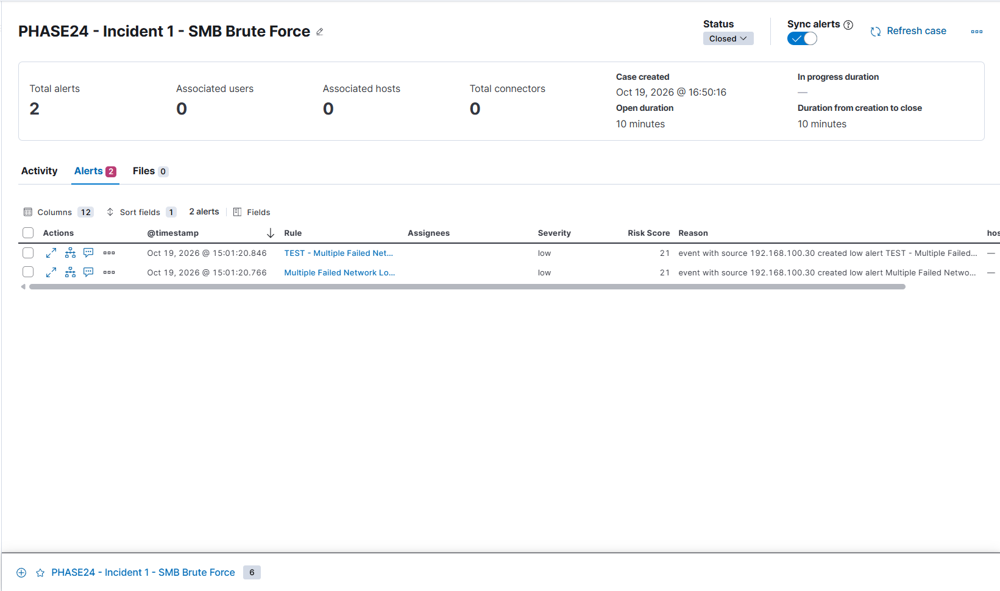

# Incident 1 — SMB Brute-Force Detection

## Incident Summary

This incident documents a controlled SMB authentication attack simulation performed in my isolated Home SOC Lab. The objective was to generate failed Windows network logons, detect suspicious authentication activity using Elastic Security, and investigate the resulting alerts.

**Incident status:** Closed  
**Environment:** Authorized, isolated virtual lab  
**Alert severity:** Low  
**Risk score:** 21  
**Alerts attached to case:** 2

## Lab Systems

| System | Role | IP Address |
|---|---|---|
| KALI-LAB | Attack simulation source | 192.168.100.30 |
| WIN01 | Windows endpoint / SMB target | 192.168.100.20 |
| SOC-ELK | Elasticsearch and Kibana monitoring | 192.168.100.10 |

## Attack Simulation

Using Kali Linux, I generated six unsuccessful SMB authentication attempts against WIN01 with intentionally incorrect credentials for the lab account `SOC-Test`.

The activity produced Windows Security Event ID **4625**, representing failed logon attempts.

The relevant logon type was **3 (Network)**, consistent with SMB authentication over the network.

## Detection Logic

An Elastic Security threshold detection rule was configured to identify repeated failed network logons.

The detection criteria included:

- Windows Security Event ID: `4625`
- Logon type: `3`
- Threshold: At least 5 failed logons
- Time window: 10 minutes
- Grouping: Source IP address

The simulation generated two alerts associated with the incident case, including the primary detection rule and a test rule.

## Investigation

I investigated the alerts in Kibana Security and confirmed that:

1. The authentication failures originated from KALI-LAB (`192.168.100.30`).
2. The target system was WIN01 (`192.168.100.20`).
3. The failed authentication attempts were generated intentionally as part of the lab simulation.
4. The detection rules identified the repeated network logon failures.

Both alerts were associated with the same incident case for investigation.

## Outcome

**Classification:** Benign Positive — authorized security testing activity correctly detected.

**Response:** Investigated and closed the incident case after confirming the source and purpose of the authentication failures.

The case was closed approximately 10 minutes after creation.

## Evidence

## Skills Demonstrated

- Windows Security Event Log analysis
- SMB authentication monitoring
- Elastic Security detection engineering
- Threshold-based alerting
- Security alert triage
- Incident investigation and case management
