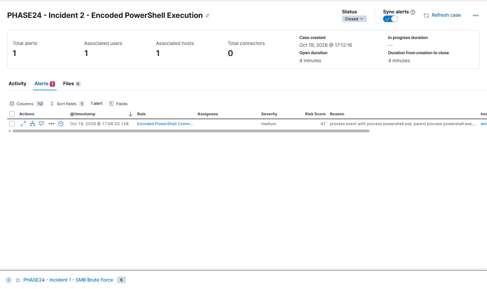

# Incident 02 — Encoded PowerShell Execution

## Incident Summary

A controlled encoded PowerShell execution was performed on WIN01 to test whether Elastic Security could detect potentially suspicious PowerShell command-line arguments.

## Environment

- Endpoint: WIN01 (192.168.100.20)
- SIEM: Elastic Security
- Telemetry: Sysmon Event ID 1 (Process Creation)
- MITRE ATT&CK: T1059.001 — PowerShell

## Test Execution

A harmless PowerShell command was encoded using Base64 and executed using the `-enco` parameter.

Original command:

```powershell
Write-Output "SOC-PHASE24-INCIDENT2"
```

The test generated process creation telemetry without performing any malicious action.

## Detection

- Detection rule: Encoded PowerShell Command Execution
- Severity: Medium
- Risk score: 47
- Alerts generated: 1

## Investigation Process

1. Executed the authorized encoded PowerShell test on WIN01.
2. Searched for Sysmon Event ID 1 in Kibana Discover.
3. Reviewed the PowerShell process command line.
4. Confirmed the encoded-command argument was present.
5. Verified that the Elastic Security detection rule generated an alert.
6. Created the Kibana case `PHASE24 - Incident 2 - Encoded PowerShell Execution`.
7. Attached the detection alert and documented the investigation.
8. Closed the case after confirming the activity was an authorized simulation.

## Findings

The detection successfully identified the encoded PowerShell execution. Encoded command-line arguments may warrant investigation because they can obscure command contents, but they are not inherently malicious.

## Resolution

- Classification: Benign Positive — authorized security simulation
- Case status: Closed
- Confirmed malicious activity: None

## Lessons Learned

- Sysmon Event ID 1 provides process creation telemetry.
- PowerShell command-line arguments are useful investigation evidence.
- Base64 encoding alone does not establish malicious intent.
- SOC analysts must validate alerts using endpoint context and supporting logs.

## Conclusion

The test demonstrated that Elastic Security detected the simulated encoded PowerShell execution and supported the complete alert investigation and case closure workflow.

## Investigation Screenshot


